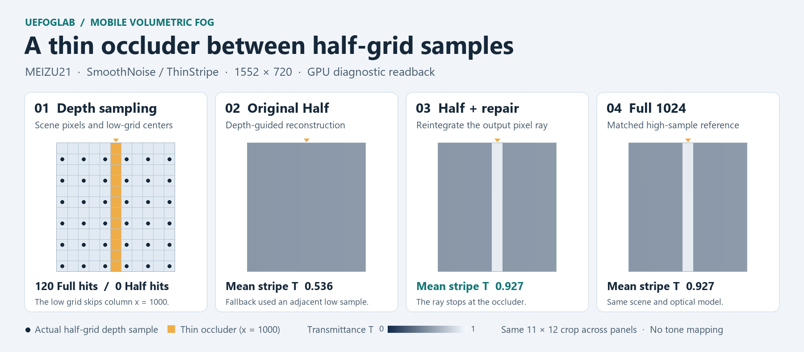
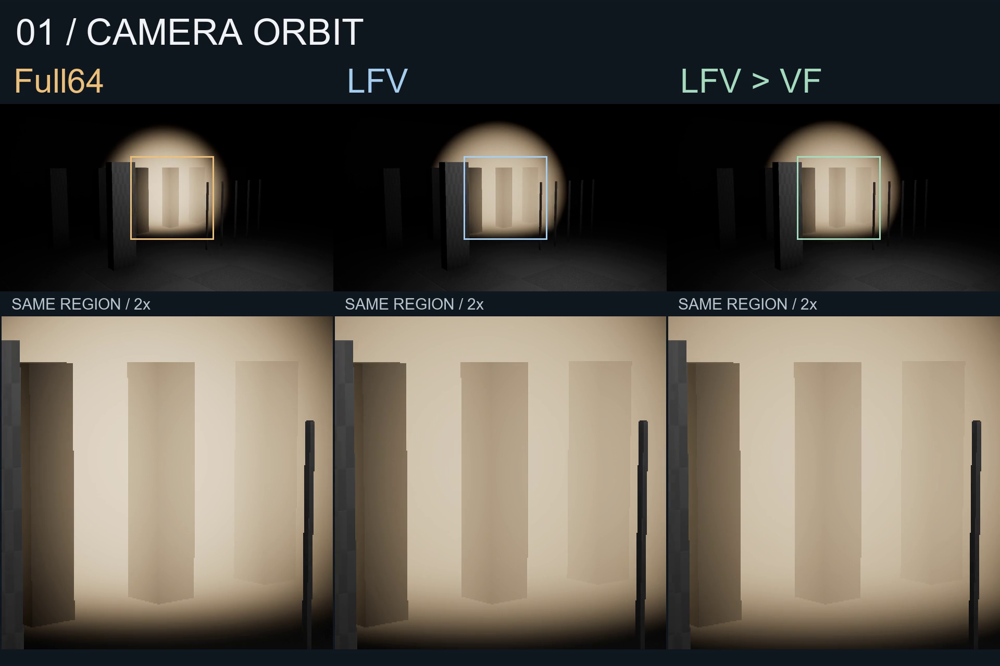

# UEFogLab

UE5.8 / C++ / HLSL local fog integration and depth-guided scattering/transmittance reconstruction. Original contributions use [MIT](LICENSE), Copyright (c)2026 xiaoran6657; [UE and third-party rights](NOTICE.md) remain reserved.

## Mobile fog: recover the thin occluder

On a fixed MEIZU21 / Vulkan ES3_1 ThinStripe test, the half grid missed a one-pixel-wide occluder. The new opt-in path reintegrates only fallback rays. On the 120 thin-hit pixels, transmittance MAE fell from **0.3912** (original Half) to **1.63×10⁻⁵**. Compared with FullN in the same APK, GPU FogTotal fell from **3.366 ms** to **1.396 ms (−58.5%)**. The result covers this fog interval and fixture. Full/High remains the default.

[中文案例](docs/mobile-fog/CASE.zh.md) · [English case](docs/mobile-fog/CASE.en.md) · [Mobile source and launch guide](docs/mobile-fog/README.md) · [Compact results](docs/mobile-fog/results.json) · [Portfolio / 作品集](https://xiaoran6657.github.io/zh/projects/uefoglab/)

The WIDE follow-up measured where this saving reversed in the tested fixtures. In a separate same-APK experiment on MEIZU21, repair used **21.6% less FogTotal at 19.70% reintegration coverage** and **4.4% more at 34.00%** than each fixture's FullN. Both modes passed the quality budgets at these endpoints. [Wide fixture launch guide](docs/mobile-fog/README.md#wide-coverage-reproduction) · [Compact WIDE data](docs/mobile-fog/wide-results.json) · [Cost and quality figure](docs/mobile-fog/media/wide-cost-quality.png)

## Desktop motion and earlier studies

The [36-second dynamic comparison](docs/showcase/releases/m6-dynamic-20261031/media/dynamic-showcase.mp4) uses real engine frames: camera orbit, moving opaque geometry, rigid local fog translation, rotating sun and Full64/HalfB64/HalfG64 edges. [Reproduce the controlled shots](docs/DYNAMIC-SHOWCASE.md), read the [capture protocol](docs/design/M6-DYNAMIC-CAPTURE.md), or inspect the [media/frame provenance](docs/showcase/releases/m6-dynamic-20261031/README.md). 30fps is offline simulation/playback time, not measured rendering FPS. [Independent review](docs/DYNAMIC-REVIEW.md) accepts this controlled display and its stated limits; the initial author candidate remains identifiable in Git history.

The [portable desktop quickstart](docs/QUICKSTART.md), [Chinese static case](docs/showcase/CASE.zh.md), [English static case](docs/showcase/CASE.en.md), [compact results](docs/showcase/data/results.json), [derived evidence](docs/showcase/evidence/summary.md) and [primary references](docs/theory/README.md) retain their fixed-fixture scope. The historical [48-second six-still edit](docs/showcase/media/showcase.mp4) remains an archive, rather than the new dynamic movie.

The RDG path integrates a sphere clipped by opaque depth, reconstructs unexposed S/T, then composites pre-exposed linear HDR. Prescribed and explicit Manual HG remain separate. The demo explicitly synchronizes its sun direction with Manual HG; custom fog still has no automatic UE light extraction, incoming-path attenuation/shadows, multiple scattering, transparent integration or temporal reconstruction. Native LFV/VF displays compare features and different models, without common-model pixel ranking. Rigid translation is not fluid simulation; depth clipping is not a volume shadow.

The earlier **Uniform Prescribed / Planes** mobile timing study measured about 0.651 ms Full / 0.918 ms HalfB / 1.144 ms HalfG in a Development build (median of four trial p50s). Its extra reconstruction cost exceeded the integration savings. The related historical thin-stripe quality fixture had about 0.428 thin-hit T MAE; its quality and timing APKs were separate. Those observations keep their original scope and are distinct from the same-APK SmoothNoise study above. The historical startup SIGSEGV remains unresolved.

Initial public snapshot e805a29 / v0.1.0-preview.1 remains unchanged. This increment extends the existing public history. [Mobile source provenance](MOBILE-FOG-SOURCE-PROVENANCE.json) records the six runtime file changes, source equivalence and derived media. Private development history, raw machine logs, packaged builds, engine assets, SDKs and font files are excluded. [DYNAMIC-SOURCE-PROVENANCE.json](DYNAMIC-SOURCE-PROVENANCE.json) records this explicit delta and tested source equivalence. [SOURCE-PROVENANCE.json](SOURCE-PROVENANCE.json) and [PUBLIC-FILES.json](PUBLIC-FILES.json) continue to describe the initial snapshot, not the new increment. Archived private source IDs identify data and are not fabricated public blob links.

Use installed UE5.8.4 for fresh desktop work and keep generated output in ignored Saved/out/work. The mobile results retain their original measured build identity. This publication does not add a fresh device run, a new tag or a GitHub Release. Coding agents assisted implementation and execution; owner learning/individual mastery are tracked separately.
