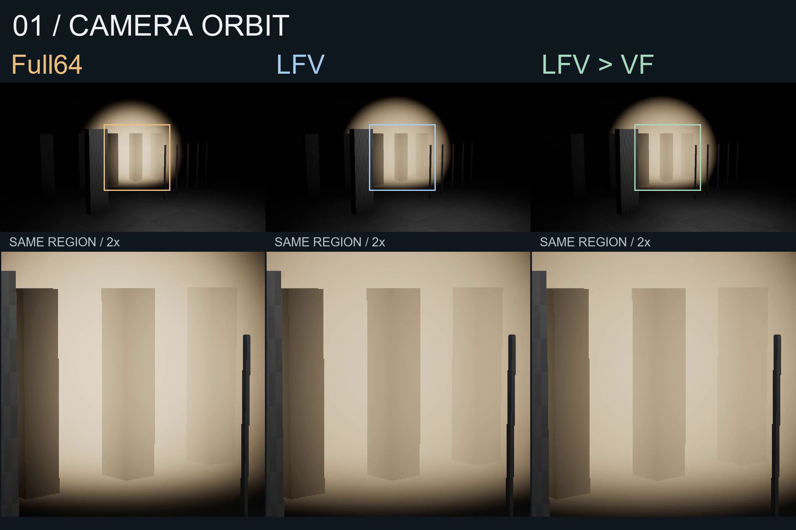

# UEFogLab

UE5.8 / C++ / HLSL local fog integration and depth-guided scattering/transmittance reconstruction. Original contributions use [MIT](LICENSE), Copyright (c)2026 xiaoran6657; [UE and third-party rights](NOTICE.md) remain reserved.

The new [36-second dynamic comparison](docs/showcase/releases/m6-dynamic-20261031/media/dynamic-showcase.mp4) uses real engine frames: camera orbit, moving opaque geometry, rigid local fog translation, rotating sun and Full64/HalfB64/HalfG64 edges. [Reproduce the controlled shots](docs/DYNAMIC-SHOWCASE.md), read the [capture protocol](docs/design/M6-DYNAMIC-CAPTURE.md), or inspect the [media/frame provenance](docs/showcase/releases/m6-dynamic-20261031/README.md). 30fps is offline simulation/playback time, not measured rendering FPS. This increment is a local author candidate pending independent review and publication.

The [portable desktop quickstart](docs/QUICKSTART.md), [Chinese static case](docs/showcase/CASE.zh.md), [English static case](docs/showcase/CASE.en.md), [compact results](docs/showcase/data/results.json), [derived evidence](docs/showcase/evidence/summary.md) and [primary references](docs/theory/README.md) retain their fixed-fixture scope. The historical [48-second six-still edit](docs/showcase/media/showcase.mp4) remains an archive, rather than the new dynamic movie.

The RDG path integrates a sphere clipped by opaque depth, reconstructs unexposed S/T, then composites pre-exposed linear HDR. Prescribed and explicit Manual HG remain separate. The demo explicitly synchronizes its sun direction with Manual HG; custom fog still has no automatic UE light extraction, incoming-path attenuation/shadows, multiple scattering, transparent integration or temporal reconstruction. Native LFV/VF displays compare features and different models, without common-model pixel ranking. Rigid translation is not fluid simulation; depth clipping is not a volume shadow.

Full64/High stays the default. Historical MEIZU21 Development BOP FogTotal is approximately .651ms Full / .918ms HalfB /1.144ms HalfG (medians of four trial p50s). Half integration costs less but reconstruction makes total fog cost higher. ThinStripe remains missed (thin-hit T MAE about.428). Quality/timing APKs, unavailable whole-frame/FPS/energy, frequency/temperature limits and historical startup SIGSEGV remain separate. New desktop movies do not establish Android motion or general temporal stability.

Initial public snapshot e805a29 / v0.1.0-preview.1 remains unchanged. This Git increment is parented only by that public history; complete private development history, raw machine logs, engine assets, SDKs, fonts and tools are excluded. [DYNAMIC-SOURCE-PROVENANCE.json](DYNAMIC-SOURCE-PROVENANCE.json) records this explicit delta and tested source equivalence. [SOURCE-PROVENANCE.json](SOURCE-PROVENANCE.json) and [PUBLIC-FILES.json](PUBLIC-FILES.json) continue to describe the initial snapshot, not the new increment. Archived private source IDs identify data and are not fabricated public blob links.

Use installed UE5.8.4 for fresh desktop work and keep generated output in ignored Saved/out/work. No new phone test, formal performance result or GitHub Release is asserted. Coding agents assisted implementation and execution; owner learning/individual mastery are tracked separately.
