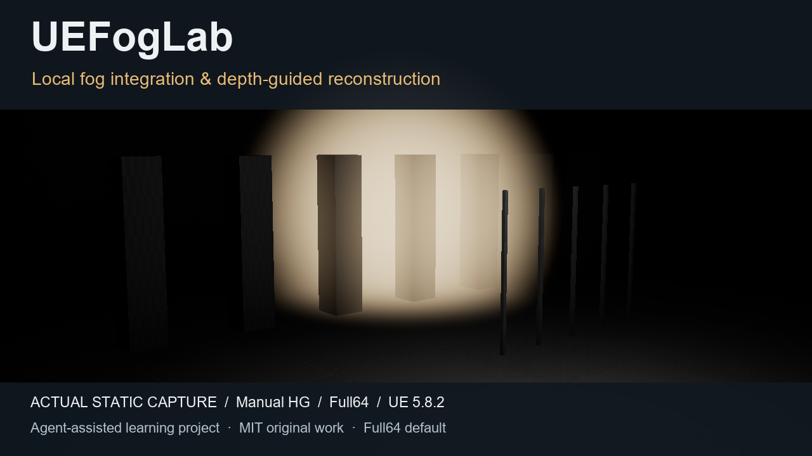

# UEFogLab

UE5.8 / C++ / HLSL local fog integration and depth-guided scattering/transmittance reconstruction. Original project code, self-written documentation and figures use [MIT](LICENSE), Copyright (c)2026 xiaoran6657; [UE and third-party rights](NOTICE.md) remain reserved.

Start with the [portable desktop quickstart](docs/QUICKSTART.md), [中文案例](docs/showcase/CASE.zh.md) or [English case](docs/showcase/CASE.en.md). The [48-second silent still-image edit](docs/showcase/media/showcase.mp4) and [compact results](docs/showcase/data/results.json) illustrate accepted fixed-fixture results and retained failures. [Derived evidence](docs/showcase/evidence/summary.md), [provenance](docs/showcase/data/provenance.json) and [primary references](docs/theory/README.md) state their scope.

The RDG path integrates a sphere clipped by opaque depth, reconstructs unexposed S/T, then composites pre-exposed linear HDR. Prescribed and explicit Manual HG remain separate. Custom fog has no UE automatic light extraction, incoming-path attenuation/shadows, multiple scattering or temporal reconstruction. Native LFV/VF images compare features/models rather than common-model truth.

Full64/High stays the default. In the fixed historical MEIZU21 Development fixture, BOP FogTotal is approximately .651ms Full / .918ms HalfB /1.144ms HalfG (medians of four trial p50s). Half integration costs less but reconstruction makes total fog cost higher. ThinStripe is still missed (thin-hit T MAE about.428). Separate quality/timing APKs, unavailable whole-frame/FPS/energy, frequency/temperature limits and the unresolved historical startup SIGSEGV are retained. Desktop sources/captures do not establish broad Android support.

This Git repository is one initial sanitized public snapshot; complete development history and private run/review logs are excluded and retained locally. Historical report/source IDs are technical identifiers, not public blob links. Config, C++/HLSL, models, thresholds and defaults match the accepted baseline; public wrapper/environment and selected-material differences are listed in [SOURCE-PROVENANCE.json](SOURCE-PROVENANCE.json). [PUBLIC-FILES.json](PUBLIC-FILES.json) describes payload bytes; the release receipt separately binds actual commit/tree/archive to avoid self hashes.

Only included source is required for a fresh desktop build and two-model numerical collection. Some archive-only drivers are intentionally omitted because their old inputs are not distributed. Android rendering implementation and CPU references are retained; the new public snapshot has not been rerun on a phone. All fresh logs stay ignored and can contain your own local paths.

Coding agents assisted implementation, experiments and independent review; owner study/individual mastery remain separate. A prepared local candidate is not a deployed website or an existing GitHub Release. Intended target xiaoran6657/UEFogLab and tag v0.1.0-preview.1 are proposed until separately published.
