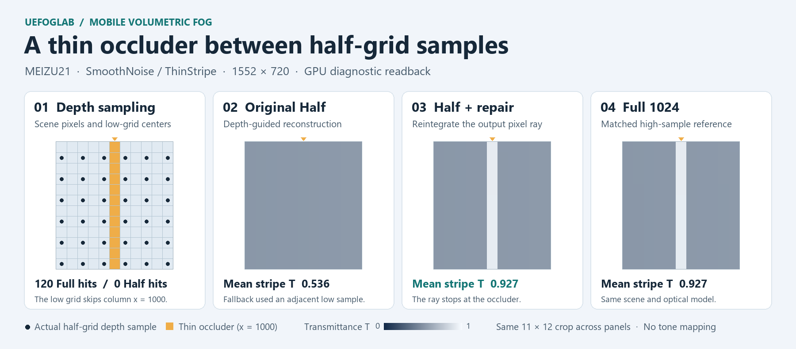

# Recovering a thin occluder in half-resolution mobile fog

UEFogLab · UE 5.8.4 · C++ / HLSL / Vulkan · [中文](CASE.zh.md)

On a fixed ThinStripe test on MEIZU21, reintegrating only fallback pixels reduced transmittance MAE on the occluder from **0.3912** for the original half-resolution path to **1.63×10⁻⁵**. The repaired path met the preset quality budgets and reduced fog-pass GPU time from **3.366 ms** to **1.396 ms (−58.5%)** versus full resolution in the same APK.

All panels use the same 11×12 crop. Dots are the observed half-grid depth sample locations, and the orange column marks the thin occluder. Transmittance uses the same [0,1] color scale across the three right panels. The reported means and errors use all 120 pixels that hit the stripe. [Figure provenance](results.json)

## Find where the occluder disappears

The scene is 1552×720 and the half-resolution fog grid is 776×360. In the test fixture, the full-resolution depth buffer hits the stripe at **120 pixels** in column 1000 (zero-based). The actual half-grid depth samples hit it **zero times**. Guided reconstruction cannot find a suitable sample and falls back to the neighbor with the largest spatial weight. That sample integrated over a longer fog segment, yielding mean transmittance **0.536** on the stripe versus **0.927** in the reference. The original half path's whole-image T MAE was only about **0.000104**, so an image-wide mean alone would hide the failure.

## Reintegrate only when guided reconstruction falls back

The low-resolution integration stays in place. At full resolution the pixel shader computes four spatial weights multiplied by depth weights. When their FP32 sum is ≤ `1e-6`, the existing reconstruction falls back. The repair uses the output pixel's own center ray and native depth to clip the visible segment of spherical fog, then recomputes optical depth with the same **64 midpoint steps** as FullN. The source function J is fixed along the ray. The shader computes transmittance T and scattering S, rounds them to the same half-precision storage convention and composites `Cout = PreExposure × S + T × Cin` in the same pixel shader.

The GPU diagnostic recorded **120 selected pixels and 7,680 executed density iterations**. Their stored S/T matched FullN bit for bit; the remaining pixels retained the original Half S/T. A shifted stripe at a different depth checked the selection and work again. The vacuum and before-entry controls still selected pixels but executed **zero** density iterations. The validation also checked the HDR output consumed by the engine. [Guided reconstruction](../../Plugins/UEFog/Shaders/Private/UEFogMobileOptimization.usf#L35) · [Repair and composition](../../Plugins/UEFog/Shaders/Private/UEFogMobileRepair.usf#L5) · [Quality validation](README.md#quality)

## Measure quality and cost separately in the same APK

Quality used a matched Full1024 reference after checking **256 → 512 → 1024** convergence with actual GPU readbacks. Cost used separate runs with diagnostics disabled and the shared Vulkan timestamp span for FogTotal. The main estimate is the median of four trial p50s per profile. A separate independent block ran each profile once.

| Path | Author median FogTotal | Independent trial p50 | Thin-hit T MAE |
|---|---:|---:|---:|
| Full resolution (FullN) | 3.366 ms | 3.358 ms | 1.63×10⁻⁵ |
| Original half resolution (FusedHalfGN) | 1.339 ms | 1.360 ms | 0.3912 |
| Half resolution + local reintegration | **1.396 ms** | **1.389 ms** | **1.63×10⁻⁵** |

The preset thin-hit T MAE limit was **0.05**. The repair met that limit and the other frozen quality budgets. Against the original Half path, the median paired cost was **+0.057 ms**. Against FullN, every author block and the independent block observed lower FogTotal. The two comparisons show the cost of restoring the occluder and the savings against integrating the whole image. [Quality and cost figure](media/repair-cost-quality.png) · [Timing protocol summary](README.md#timing)

This result covers the fog span in a fixed 1552×720 fixture on MEIZU21 / Adreno 750, using Vulkan ES3_1 Mobile Forward HDR. Full/High remains the default. Only **0.011%** of pixels required repair here. A follow-up should vary the measured coverage of repair work to find when the savings shrink or disappear. [Launch and reproduction notes](README.md) · [Compact data](results.json)
