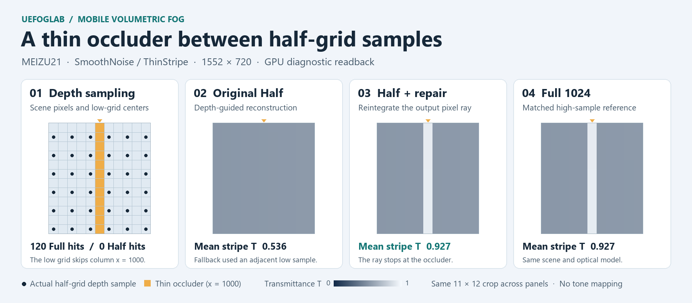
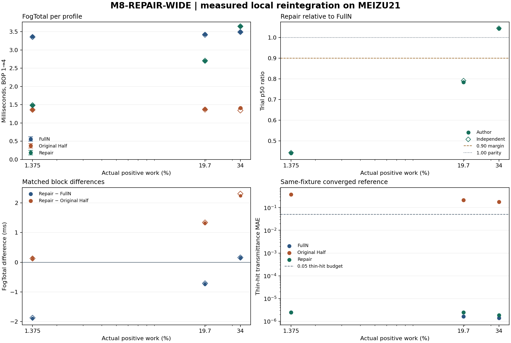

# 半分辨率移动雾的薄遮挡补算与成本边界

UEFogLab · UE 5.8.4 · C++ / HLSL / Vulkan · [English](CASE.en.md)

在 MEIZU21 的固定 ThinStripe 场景中，只对回退像素重新积分，薄遮挡透射率 MAE 从原 Half 的 **0.3912** 降至 **1.63×10⁻⁵**。补算达到预设质量门槛，同一 APK 中的雾通道 GPU 耗时较全分辨率从 **3.366 ms** 降至 **1.396 ms（−58.5%）**。

图中四格使用同一个 11×12 像素裁剪。左图的点是实际回读的半格深度采样位置，橙色标出细条所在列；后三格在同一 [0,1] 色标上显示透射率 T。图注均值和下文误差均覆盖完整细条的 120 个命中像素。[图与数据的来源](results.json)

## 先确认是哪里丢了信息

场景是 1552×720，半分辨率雾格是 776×360。主场景中，薄遮挡在全分辨率深度的第 1000 列（从零开始）命中 **120 个像素**，半格实际深度样点命中 **0 个**。四邻重建没有合适的样本，回退到空间权重最大的邻格。它借到了较远深度对应的雾积分，透射率从参考的平均 **0.927** 掉到 **0.536**，这条边因此丢失。原 Half 的整图 T MAE 只有约 **0.000104**，看整图均值很容易错过这个问题。

## 只对回退像素恢复原分辨率射线

低格仍做原来的积分。全分辨率像素着色器先计算四邻的空间权重与深度权重；当两者乘积的 FP32 总和 ≤ `1e-6`，进入原有回退分支。修复在这里读取**当前输出像素的原生深度**，用它自己的像素中心射线裁剪球形雾的可见段，再用与 FullN 相同的 **64 步中点积分**重算光学厚度。沿射线的源函数 J 为固定值；由光学厚度求透射率 T 与散射 S，并按原半精度规则舍入。最后在同一个像素着色器内合成 `Cout = PreExposure × S + T × Cin`。

主场景的 GPU 诊断实际记录了 **120 个选中像素、7,680 次密度迭代**。选中的 S/T 与同包 FullN 逐位一致，其他像素保持原 Half 的 S/T。偏移且改变深度的控制也复现了选路和工作；真空及遮挡在入雾前的控制仍可选中，但实际执行 **0** 次密度迭代。诊断验证同时检查了引擎实际消费的 HDR 输出。[四邻重建](../../Plugins/UEFog/Shaders/Private/UEFogMobileOptimization.usf#L35) · [补算与合成](../../Plugins/UEFog/Shaders/Private/UEFogMobileRepair.usf#L5) · [质量验证方法](README.md#quality)

## 用同一 APK 分开验证质量和耗时

质量以同场景、同模型的 Full1024 为高样本参考，先用实际 **256 → 512 → 1024** 回读检查收敛。成本来自关闭诊断的独立采样，读取 Vulkan 时间戳共同边界内的 FogTotal。主表每档取四次试验各自 p50 的中位数。另有一轮独立采集，每档一次，单列。

| 路径 | FogTotal 作者中位数 | 独立单次 p50 | 薄遮挡 T MAE |
|---|---:|---:|---:|
| 全分辨率 FullN | 3.366 ms | 3.358 ms | 1.63×10⁻⁵ |
| 原半分辨率 FusedHalfGN | 1.339 ms | 1.360 ms | 0.3912 |
| 半分辨率 + 局部补算 | **1.396 ms** | **1.389 ms** | **1.63×10⁻⁵** |

预设的薄遮挡 T MAE 上限是 **0.05**，补算同时通过了其余冻结质量门槛。相对原 Half，补算的同组配对中位耗时增量是 **0.057 ms**；相对 FullN，四组配对和独立组均观察到更低的 FogTotal。前者回答“修回漏采花多少”，后者回答“质量达标后比整图积分省多少”。[质量与成本图](media/repair-cost-quality.png) · [正式计时口径](README.md#timing)

这次稀疏实验实际补算了约 **0.011%** 的画面。默认档位为 Full／High。

## 补算覆盖率升高后，哪一档开始更慢？

后续 WIDE 实验在同一台 MEIZU21 上使用另一份 Development Android ASTC APK。三档各自在该 APK 内配对。两档宽夹具使用相同的 632 条细条、600 cm 遮挡深度和 1552×720 场景，只调整细条高度。覆盖率取实际执行密度循环的像素比例。最高档有 400,032 个回退像素，其中 20,118 个因可见雾段为空而执行零次循环。

| 实际补算覆盖率 | 补算像素 | FullN → 修复（作者组 FogTotal） | 修复／FullN（作者／独立） |
|---:|---:|---:|---:|
| 1.37457% | 15,360 | 3.367 → 1.483 ms | 44.04%／44.23% |
| 19.69734% | 220,106 | 3.434 → 2.694 ms | 78.44%／79.13% |
| 33.99860% | 379,914 | 3.493 → 3.646 ms | 104.39%／104.49% |

三档 FullN 和修复都通过同场景收敛参考下的质量门槛，原 Half 的薄条透射率 MAE 均超过 0.05。FogTotal 的作者列为每档三次试验 p50 的中位数，独立组每档一次。**19.70% 档仍有至少 10% 的预设余量，34.00% 档四组配对均比 FullN 慢。** 中间高度待测。细条高度也改变了场景遮挡和雾内光程，结论限于这台设备、本组夹具和雾通道。

[WIDE 精简数据](wide-results.json) · [源码与图表来源](wide-source-provenance.json) · [宽夹具复现入口](README.md#wide-coverage-reproduction)
