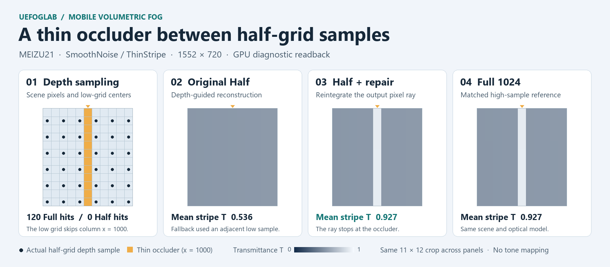
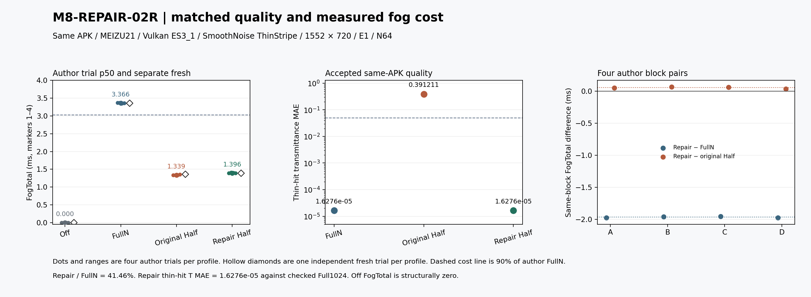

# Mobile fog: repairing thin occluders

[中文案例](CASE.zh.md) · [English case](CASE.en.md) · [Compact results and provenance](results.json) · [Shader](../../Plugins/UEFog/Shaders/Private/UEFogMobileRepair.usf) · [Runtime entry](../../Plugins/UEFog/Source/UEFog/Private/UEFogMobileReconstruction.cpp)

The opt-in SmoothNoise path uses fused half-resolution reconstruction and local reintegration. It builds on the earlier mobile fusion and Uniform analytic shaders. Full/High is the default. The sparse and WIDE studies below have separate measured build identities.

## Quality

In the fixed ThinStripe test the full depth buffer saw 120 stripe pixels. The canonical 776×360 half grid sampled none. The original depth-guided shader fell back to a neighboring integral. The repair follows the original FP32 weight-sum threshold, `sum <= 1e-6`. At a fallback pixel it clips that pixel's own full-resolution ray to opaque depth, integrates the same spatial extinction with 64 midpoint steps, rounds S/T to half storage, and composites into pre-exposed linear HDR in the same pixel shader. The model uses a prescribed source function; this is a camera-ray integration and reconstruction experiment.

The GPU diagnostic observed 120 selected pixels and 7,680 executed density iterations in the main fixture. Their S/T matched the same-APK FullN bit for bit; unselected pixels retained the original Half S/T. The validation checked the HDR output consumed by the engine. A shifted stripe at a different depth reproduced the selection and work, while the vacuum and before-entry controls selected pixels with zero actual density iterations.

Thin-hit transmittance MAE uses a matched Full1024 reference with recorded 256 → 512 → 1024 convergence. The repair met the predeclared ≤0.05 thin-hit threshold and the other recorded quality budgets. This reference and the FullN path used for cost are separate roles.



## Timing

Development APK, UE 5.8.4, MEIZU21 / Adreno 750, Vulkan ES3_1 Mobile Forward HDR, 1552×720, ThinStripe, SmoothNoise, N64 and pre-exposure 1. Quality and cost used the **same APK in separate runs**. Formal runs disabled diagnostics and readback. FogTotal is the shared Vulkan bottom-of-pipe timestamp interval between markers 1 and 4. The repair's last span includes reconstruction, reintegration and composition together.

| Profile | Median of four trial p50s | Independent trial p50 | Thin-hit T MAE |
|---|---:|---:|---:|
| FullN | 3.366 ms | 3.358 ms | 1.63×10⁻⁵ |
| Original Half | 1.339 ms | 1.360 ms | 0.3912 |
| Half + local reintegration | 1.396 ms | 1.389 ms | 1.63×10⁻⁵ |

The repair took 41.46% of FullN's median FogTotal, a **58.54% reduction** in the measured fog scope. Its author paired median was −1.966641 ms versus FullN and +0.056797 ms versus original Half. All four author comparisons and the independent block agreed on the direction versus FullN. The Off profile was a control, with logical FogTotal zero; it does not enter the reduction calculation.

The [compact data](results.json) retain all 16 author and four independent trial p50s, the selected work and the identity of the measured build. To recompute, take the median of the four author p50s per profile; use `1 - medianRepair / medianFull` for the reduction and subtract inside each block before taking a median for a paired difference. The independent block stays separate. The raw ticks were independently recomputed before publication; the raw streams and local automation archive are not distributed.



This sparse result covers one device, one fixture and the fog interval. About 0.011% of the scene pixels needed reintegration. WIDE tested higher workloads with its own matched comparisons.

## Run the optional fixture from source

Start with the [desktop build and CPU checks](../QUICKSTART.md). To exercise this **Android-only** entry, use an installed UE 5.8.4 with its Android toolchain, and package a Development Android (ASTC) build of this project. The Android config selects Vulkan, Mobile Forward HDR and the procedural Entry map. Keep the packaged app's measured view extent at 1552×720 for a matched comparison. Fresh builds carry their own identities; the historical APK is not a download.

Supply these Unreal arguments with your Android launch setup:

```text
-FogLabMobileRepair=FusedHalfRepairN -FogLabRepairDensity=SmoothNoise -FogLabReconFixture=ThinStripe -FogLabReconGrid=Half -FogLabReconNear=600 -FogLabReconSigma=0.35 -FogLabPreExposure=1 -FogLabReconReadback=0
```

Change only `FogLabMobileRepair` to `FullN`, `FusedHalfGN`, or `Off` for the fixed comparison profiles. The `Half` grid option selects the comparison grid; FullN still integrates at full resolution. Avoid combining this launch with older probe/fog/reconstruction entries.

For a separate diagnostic capture, use `FogLabReconReadback=1` with a fresh 32-digit hex `FogLabMobileRun`, a writable app-private `FogLabMobileOutput`, and your build and revision identities via `FogLabBaselineBuild` and `FogLabBaselineSource`. Full256/Full512/Full1024 select the high-sample quality profiles. The formal performance entry validates its own private output, normal path, run identity and fixed settings; see [the runtime checks](../../Plugins/UEFog/Source/UEFog/Private/UEFogMobilePerformance.cpp). The public source includes these runtime facilities and the summary above. Reproducing the original physical acquisition protocol requires your own separate capture and timing setup.

## Wide coverage reproduction

For the WIDE fixtures, keep the settings above and change `FogLabReconFixture` to `RepairCoverage128`, `RepairCoverageWide432` or `RepairCoverageWide712`. Use FullN, FusedHalfGN and FusedHalfRepairN within each fixture. [Geometry and heights](../../Plugins/UEFog/Source/UEFog/Public/UEFogMobileCoverageFixture.h)

The [compact WIDE data](wide-results.json) contain 27 author and nine independent trial p50s, actual executed repair counts, the per-fixture quality results and the measured build identity. Compute the author ratio from the medians of each profile's three trial p50s. Keep the independent block separate. The [cost and quality figure](media/wide-cost-quality.png) shows the 0.90 margin and 1.00 parity lines. Intermediate heights remain unmeasured. [WIDE source and media provenance](wide-source-provenance.json)

[Sparse source and media provenance](../../MOBILE-FOG-SOURCE-PROVENANCE.json) · [License and third-party notices](../../NOTICE.md)
