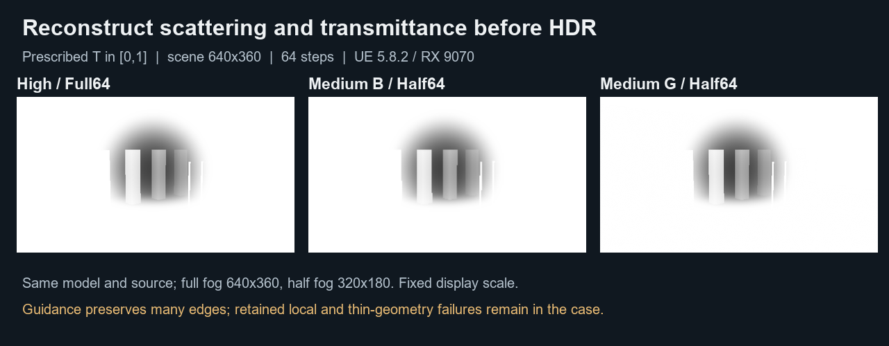
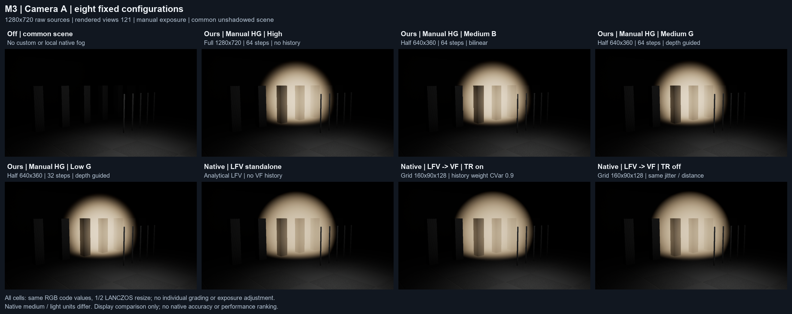
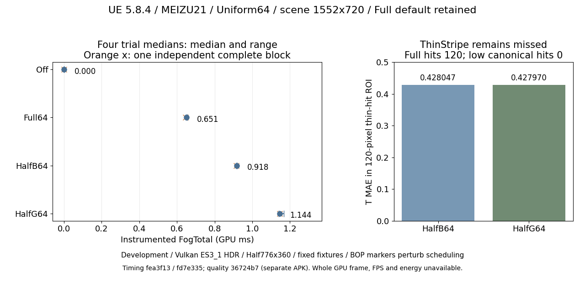
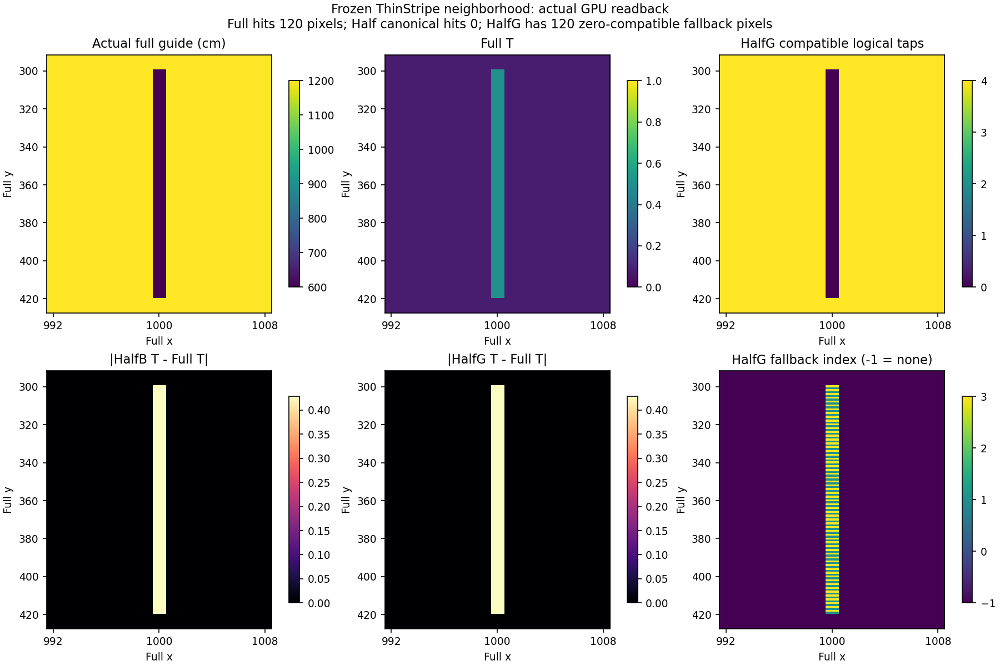

# UEFogLab：局部雾积分与深度引导重建

这是一个 UE5.8 / C++ / HLSL 渲染学习工程：先把散射与透射率算对，再讨论降低雾分辨率的质量和成本。在已记录的 MEIZU21 场景，Half 积分更便宜，但重建让 FogTotal 高于 Full；**Full64/High 保持默认**。原创代码、自写文档和图表采用MIT（2026 xiaoran6657）；UE及第三方保留各自条款。这是尚未实际发布的独立公共源码候选。

封面来自 UE5.8.2 / RX9070 的实际 Manual HG Full64 静帧，仅增加说明文字。开发、实验执行与独立审查由 coding agents 辅助推进；本人学习、独立推导和技术掌握程度没有由 agent 代签。[静帧剪辑](media/showcase.mp4)为48秒无音轨，24fps是编码属性，不是实时性能或运动证据。

## 问题与实现路径

半分辨率雾格的宽高各减半，积分像素约为全格的四分之一，但不透明深度边缘可能混合，细遮挡也可能从低格采样中消失。这里把场景分辨率与雾格分开，分别检验积分、重建和最终合成。

1. C++ 生成固定几何、相机和介质参数；`Plugins/UEFog` 的 RDG 路径处理自研雾。
2. 对球形介质做深度裁剪和分段积分，存储未曝光的 `S.rgb` 与 `T`。消光单位为 m⁻¹，射线/场景几何以cm表示，积分显式换算单位。
3. 使用双线性或深度引导权重重建 S/T，再在线性HDR中合成 `Cout = PreExposure * S + T * Cin`；Cin是引擎已有预曝光场景色。
4. 原始读回、独立CPU参考、截图和GPU计时使用不同入口。截图不代替浮点数值，读回也不代替无诊断计时。

桌面两模型共用精确整数中心深度选择：`((2*p+1)*ViewSize)/(2*FogSize)`，随后加一次 ViewMin。该修复关闭了偶数半格的错像素选择；历史错误数组仍作为拒收反例。真实非零 ViewRect 原点与一般场景理想几何不由整数公式或固定夹具自动证明。

| 模型/路径 | 实际含义 | 限定 |
|---|---|---|
| Prescribed | 固定源函数J=(.35,.60,.90)，`S=J*(1-T)`的受控光学夹具 | 不是UE场景受光 |
| ManualDirectionalHG | 显式手动方向、albedo、归一化HG；`Jray=albedo*E*HG(k·(-ray),g)`，补偿光学厚度后闭式S/T | 入射光路透射/可见性固定1，J沿每条相机射线恒定 |
| NativeLFV | UE原生standalone LFV | 密度形状/覆盖、照明和单位与自研不同 |
| LFV→VF | 局部LFV密度注入原生VF网格 | 另有离散、照明和历史行为，不与standalone混称 |

两条自研光学模型均未加入 UE自动取光、光源路径衰减、体积阴影、多次散射、透明整合或时域重建。移动实测只覆盖 Uniform Prescribed，不能从桌面Manual外推。

## 同模型质量与重建反例

图为 Prescribed/radial，UE5.8.2、RX9070/D3D12 SM6，scene640×360，Full640×360 / Half320×180，64步；T显示范围固定[0,1]。它从[已接纳的S/T图](media/desktop-st.png)裁出High、Medium B/G的T格并统一缩放，不新增数值结果。高步数Reference只在冻结夹具的收敛范围内使用，不是普遍物理真值。

[保留的同模型局部反例](media/desktop-counterexample.png)和[Manual显示边缘反例](media/native-edge.png)同时可见。后者为 UE5.8.2 / RX9070、Manual HG、1280×720场景、640×360半格、64步：采后说明性选点(799,411)相对High的最大RGB码值差为 B=0、G=2。High是显示基线，码值差不是S/T精度；深度引导不保证处处优于双线性。依据：[映射修复](evidence/summary.md)、[Manual研究](evidence/summary.md)、[原生展示/选点规则](evidence/summary.md)。

## 原生功能与模型差异

该历史图采自 UE5.8.2 / RX9070 / D3D12 SM6，固定1280×720、手动曝光、无阴影场景，源`7730eba`。Ours为Manual HG：albedo.8、g.5、相对E=(4,3,2)、归一化photon direction(-1,-1,.15)；Full64与Half64 B/G分别为1280×720和640×360。LFV与VF的密度分布、height8覆盖门、照明尺度与单位不同，VF网格为160×90×128。它是功能、有效配置和显示路径对比，**不作原生数值真值或性能排名**。模型差异与静态观察限定见[派生公开摘要](evidence/summary.md)；旧报告仅作历史哈希身份。

## 真机质量与成本：改善有边界

以下均为 UE5.8.4/CL58902052、MEIZU21/Adreno750、Vulkan ES3_1 Mobile Forward HDR、MSAA1/保留native depth、ViewMin0、scene1552×720、Full1552×720/Half776×360、Uniform Prescribed64、sigma=.35m⁻¹、P1。质量与计时是**不同APK**：质量源`36724b7`；计时native`fea3f13`/host`fd7e335`，Development/Planes夹具。原始身份和精确值见[小数据](data/results.json)。

| 模式 | FogTotal ms | 四trial中位数范围 ms | 独立完整block的单trial p50 ms |
|---|---:|---:|---:|
| Full64 | 0.650651 | 0.647083–0.655391 | 0.646771 |
| HalfB64 | 0.917552 | 0.916146–0.920208 | 0.915677 |
| HalfG64 | 1.144466 | 1.141562–1.167135 | 1.144531 |

作者列为四个trial p50的中位数，总计16个平衡trial/7708帧（包含Off）；独立为一个完整block、4trial/1925帧。范围不是置信区间。BOP FogTotal含marker/barrier及当前Full的R32 guide成本，插桩可能扰动调度；子scope各自的中位数不能直接相加成总中位数。完整GPU frame、FPS、能耗均不可用；频率不可读，电池温度只是代理，不能证明恒频。

| 独立质量包，相对actual Full64 | HalfB64 | HalfG64 |
|---|---:|---:|
| Planes整体T RMSE | 0.010698195 | 0.001453393 |
| plane-step ROI T RMSE | 0.038466699 | 0.000029972 |
| near-sky ROI T RMSE | 0.063660286 | 0.000276456 |
| Planes整体HDR Blue RMSE | 0.010602295 | 0.001373467 |
| ThinStripe thin-hit T MAE | 0.428046672 | 0.427970378 |

实际Full64只作同模型/同档参照，不表示其物理误差为零。Guided在上述Planes误差更低，但ThinStripe的120个Full命中像素在低格canonical采样中命中0个，HalfG全部走零兼容fallback。thin-hit为固定[1000,300,1001,420) ROI；完整Planes ROI坐标在小数据中。全图预算通过不能解释为细遮挡已恢复，也不推荐Half替换Full。

[Planes固定ROI图](media/mobile-planes-roi.png)展示不同深度边缘的受控情况。依据：[RECON质量/反例](evidence/summary.md)、[PERF成本/限制](evidence/summary.md)、[协调接纳](evidence/summary.md)。图表重画只复用已接纳数据，没有重新采性能或把计时APK写成全套新质量包。

## 复现、限制与下一步

[公共quickstart](QUICKSTART.md)从干净源码构建Editor/CPU并新采两模型。M5-01作者和独立者在各自无项目生成物的目录用5.8.4新构建、CPU与Prescribed/Manual GPU复现，8份历史核心数组相同；仍保留理想几何差异，只接纳条件于实际解码深度的光学。引擎/DDC缓存允许复用，不能称全冷缓存构建。

移动支持限于记录的一台手机、渲染路径和固定夹具；历史启动SIGSEGV根因未定，成功重试不代表稳定性修复。一般场景/尺寸、真实非零ViewRect、桌面正式性能、移动Manual、运动/时域、跨设备、whole-frame/FPS/能耗与本人学习继续挂账。后续按测量决定优化，并单列启动稳定性调查。

本案例与[媒体生成器](build_showcase.py)不需要原始Saved即可阅读或重画关键展示图；重新验证GPU数值需按quickstart重新采样。理论入口见[主参考索引](references.md)：Beer–Lambert/源函数、HG、联合双边重建、RDG和UE原生雾。这里只保留链接和自写说明，第三方理论原文不随公开候选分发。

本页为M5-PUB-01新派生公开摘要。旧报告/提交只作历史身份，不在此独立Git内；来源、范围和实现映射见[技术来源](data/provenance.json)。原始报告和完整本地开发历史保持。
